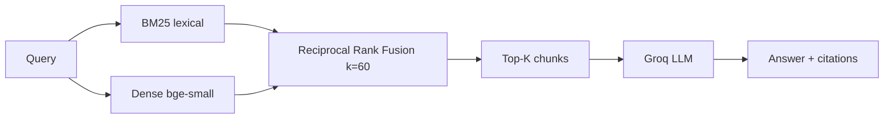

# 02 — Hybrid RAG (BM25 + Dense + RRF)

**Project 02 of 50 — AI Engineering Portfolio**

Hybrid retrieval that combines **lexical BM25** and **dense semantic search**, fused with **Reciprocal Rank Fusion**, on **Cloudflare Workers**.

## 🌐 Live Demo
- **App:** https://hybrid-rag.deepvision-aiportfolio.workers.dev
- **GitHub:** https://github.com/deepvisionkararhaider-crypto/hybrid-rag

## 🎯 Problem
Lexical search (BM25) nails exact keywords, SKUs and error codes but misses paraphrases. Dense vector search captures meaning but can miss exact identifiers. Fusing both beats either alone.

## 🏗️ Architecture

RRF ignores incomparable raw scores and fuses by rank: each doc earns `1/(k+rank)` from every retriever (k=60). No score normalization required.

## ✨ Features
- BM25 (k1=1.5, b=0.75) computed in-Worker over the D1 corpus
- Dense cosine recall via Workers AI `bge-small-en-v1.5`
- RRF fusion with per-result BM25/dense score + rank attribution
- Adjustable hybrid weight (alpha) in the UI
- Groq LLM grounded answers with citations
- Error handling + smoke tests

## 🛠️ Stack
Cloudflare Workers · Hono · Workers AI (BGE-small) · D1 · Groq · TailwindCSS

## 📁 Structure
`src/worker.js` (API + UI) · `src/core.js` (chunking, embeddings, cosine, BM25, RRF, Groq, D1)

## 🔑 Env
```bash
GROQ_API_KEY=          # secret
LLM_MODEL=openai/gpt-oss-120b
```

## 🚀 Run
```bash
npm install
echo "GROQ_API_KEY=your_key" > .dev.vars
npm run dev && BASE=http://localhost:8787 bash tests/smoke.sh
```

## 📡 API
`GET /api/health` · `GET /api/stats` · `POST /api/documents` · `POST /api/search` `{query, top_k, alpha}` · `POST /api/query`

## 🧪 Testing
**Verified:** `7 passed, 0 failed` (health, fusion, ingest, hybrid search, BM25 candidates, malformed input, query).

## 📊 Performance
Per-request timings are returned in `retrieval_time_ms` / `generation_time_ms`. Not benchmarked at scale yet.

## 📄 License
MIT.
